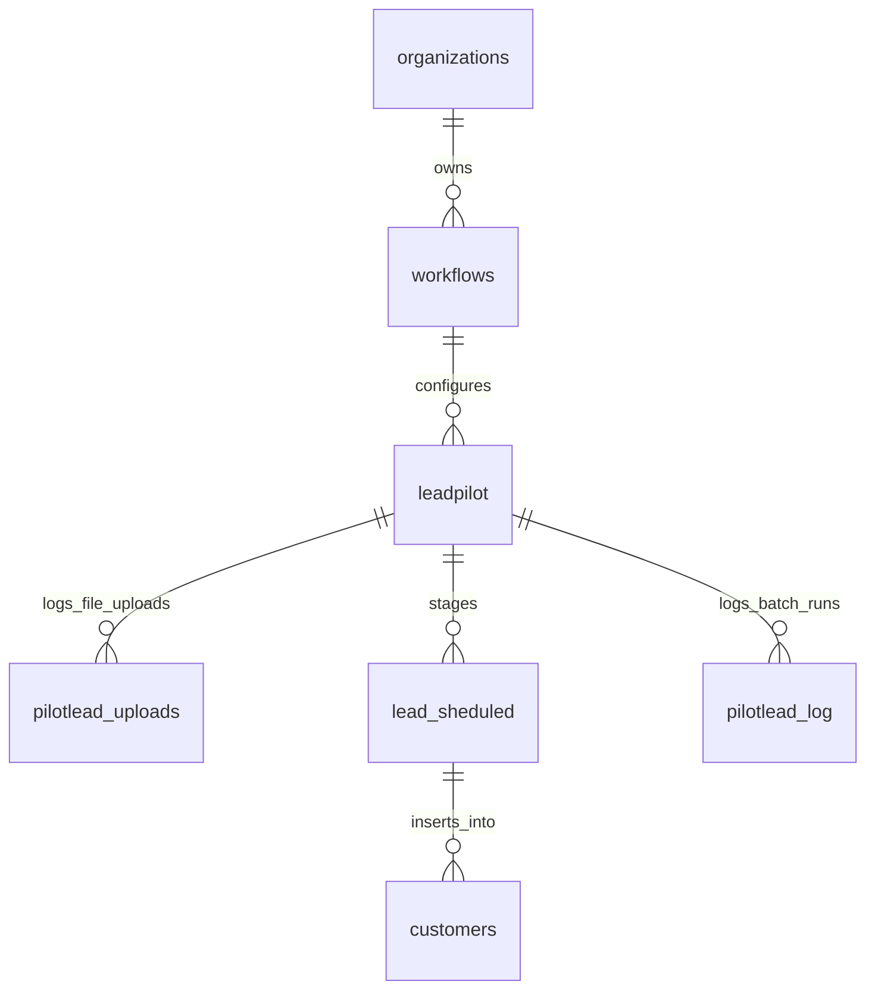
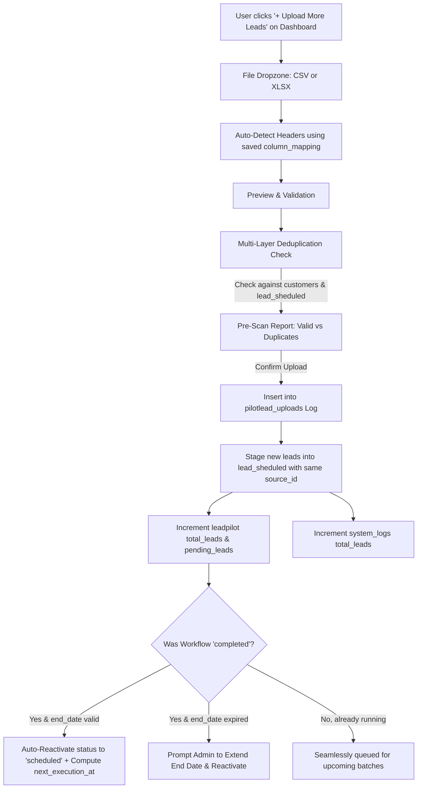
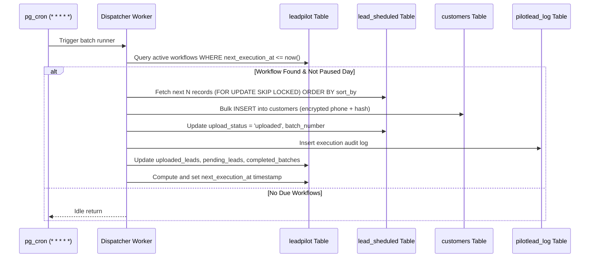

# Rynxly CRM — LeadPilot (Scheduled Bulk Upload Workflow) Specification

## 1. Executive Summary & Overview

**LeadPilot** is a background-driven, scheduled bulk lead ingestion and distribution workflow engine built into Rynxly CRM. It enables authorized leadership (**Level 1 Global Superadmin / CEO** and **Level 2 Client Organization CEO**) to upload massive lead datasets (CSV / Excel) and distribute them into targeted active CRM campaigns in scheduled micro-batches across multiple days, respecting custom pause rules, lead quotas, and distribution strategies.

### Key Capabilities:
* **Initial File Seeding & Continuous Ingestion**: During the initial workflow configuration wizard, the user uploads their first lead file and maps columns. Once configured, **users can upload data multiple times into the same workflow** at any time (e.g. weekly or monthly top-ups). All newly appended leads are staged seamlessly and picked up by upcoming scheduled batches without needing to re-configure the entire workflow.
* **Autonomous Execution**: The entire batch execution is **100% backend-driven**, meaning workflows run autonomously even when users close their browser, log out, or switch devices.

---

## 2. Page & Navigation Architecture

```
/workflow (Root Workflow Catalog)
│
└── 📁 LeadPilot (Card / Entry Tile)
    │
    ├── /workflow/pilotlead (Workflow Instances List Page)
    │   ├── Stats per workflow row:
    │   │   ├── Workflow Name & Target Campaign
    │   │   ├── Uploaded Leads vs. Pending Leads
    │   │   ├── Completed Batches / Total Estimated Batches
    │   │   ├── Active / Pause Toggle Switch
    │   │   ├── Soft Delete / Cancel Toggle
    │   │   └── Next Execution Timestamp (IST)
    │   ├── "+ Add New Bulk Upload" Button (Opens 5-Step Configuration Wizard with Initial File)
    │   └── Row Action Menu: "+ Upload More Data", "Pause/Resume", "View Dashboard", "Delete"
    │
    └── /workflow/pilotlead/[id] (Dedicated Workflow Dashboard)
        ├── Top Action Bar: "+ Upload More Leads" Button (Modal to append new CSV/Excel)
        ├── Real-Time KPI Cards (Total Leads, Ingested, Pending, Success Rate, Next Run)
        ├── Staged Leads Viewer (Filter by Pending / Uploaded / Failed / Skipped)
        ├── Batch Execution Logs Table (from pilotlead_log)
        ├── File Upload History Log (from pilotlead_uploads: File Name, Date, Rows, Duplicates, Uploader)
        └── Workflow Configuration Summary (Schedules, Agent allocations, Pause rules)
```

### URL Rewrites (next.config.ts)
* `/workflow` ➔ `/portal/workflow`
* `/workflow/pilotlead` ➔ `/portal/workflow/pilotlead`
* `/workflow/pilotlead/:id` ➔ `/portal/workflow/pilotlead/:id`

---

## 3. Database Schema Design

The system is built on **5 core PostgreSQL tables** in Supabase, enforcing strict multi-tenant isolation via `organization_id`.



### Table 1: `workflows` (Future-Ready Workflow Registry)
Enables registering future workflow types (e.g. Call Cadence, Re-engagement, WhatsApp Sync) while maintaining multi-tenant organization isolation.

```sql
CREATE TABLE IF NOT EXISTS public.workflows (
    id UUID PRIMARY KEY DEFAULT gen_random_uuid(),
    organization_id UUID NOT NULL REFERENCES public.organizations(id) ON DELETE CASCADE,
    name TEXT NOT NULL,                -- e.g. 'LeadPilot'
    slug TEXT NOT NULL,                -- e.g. 'pilotlead'
    description TEXT,
    icon TEXT DEFAULT 'fi-rr-branching',
    is_active BOOLEAN DEFAULT true,
    created_by UUID REFERENCES auth.users(id),
    created_at TIMESTAMPTZ DEFAULT now(),
    updated_at TIMESTAMPTZ DEFAULT now()
);

CREATE INDEX IF NOT EXISTS idx_workflows_org ON public.workflows(organization_id);
```

---

### Table 2: `leadpilot` (Bulk Upload Workflow Configurations)
Stores the master configuration, scheduling parameters, distribution quotas, remembered column mappings, and live progress metrics.

```sql
CREATE TABLE IF NOT EXISTS public.leadpilot (
    id UUID PRIMARY KEY DEFAULT gen_random_uuid(),
    organization_id UUID NOT NULL REFERENCES public.organizations(id) ON DELETE CASCADE,
    campaign_id TEXT NOT NULL REFERENCES public.campaigns(id) ON DELETE RESTRICT,
    name TEXT NOT NULL,
    source_id TEXT NOT NULL,                   -- Master Source ID matching system_logs (e.g. 'SRC-LP-7WXJ7M')
    status TEXT NOT NULL DEFAULT 'scheduled', -- 'draft', 'scheduled', 'running', 'paused', 'completed', 'cancelled'
    
    -- Batch Scheduling
    batches_per_day INTEGER NOT NULL CHECK (batches_per_day BETWEEN 1 AND 20),
    batch_times JSONB NOT NULL,                -- Array of times in HH:mm e.g. ["10:00", "13:00", "17:00"]
    batch_size INTEGER NOT NULL CHECK (batch_size > 0),
    pause_days TEXT[] DEFAULT '{}',            -- e.g. ARRAY['Sunday', 'Saturday']
    start_date DATE NOT NULL,
    end_date DATE NOT NULL,
    
    -- Assignment & Distribution Configuration
    assignment_type TEXT NOT NULL DEFAULT 'unassigned', -- 'unassigned' | 'assigned'
    assigned_agents_config JSONB DEFAULT '{}'::jsonb,   -- { mode: 'uniform' | 'custom_ratio', allocations: [...] }
    agent_cursor_index INTEGER DEFAULT 0,               -- Continuous round-robin pointer
    
    -- Sorting & Priority Configuration
    sort_by TEXT NOT NULL DEFAULT 'file_order',         -- 'name_asc', 'name_desc', 'expiry_date_asc', 'expiry_date_desc', 'file_order'
    
    -- Remembered Column Mappings (Used for auto-mapping on subsequent uploads)
    column_mapping JSONB DEFAULT '{}'::jsonb,           -- e.g. {"name": "Customer Name", "phone": "Contact Number"}
    total_files_uploaded INTEGER DEFAULT 1,             -- Incremented each time user appends a file
    
    -- Live Tracking Metrics
    total_leads INTEGER DEFAULT 0,
    uploaded_leads INTEGER DEFAULT 0,
    pending_leads INTEGER DEFAULT 0,
    failed_leads INTEGER DEFAULT 0,
    skipped_leads INTEGER DEFAULT 0,
    completed_batches INTEGER DEFAULT 0,
    next_execution_at TIMESTAMPTZ,
    last_executed_at TIMESTAMPTZ,
    
    created_by UUID REFERENCES auth.users(id),
    created_at TIMESTAMPTZ DEFAULT now(),
    updated_at TIMESTAMPTZ DEFAULT now()
);

CREATE INDEX IF NOT EXISTS idx_leadpilot_org ON public.leadpilot(organization_id);
CREATE INDEX IF NOT EXISTS idx_leadpilot_status_next_exec ON public.leadpilot(status, next_execution_at);
```

---

### Table 3: `pilotlead_uploads` (File Upload History Audit Table)
Tracks each file uploaded into the workflow (initial upload during wizard + subsequent top-up uploads).

```sql
CREATE TABLE IF NOT EXISTS public.pilotlead_uploads (
    id UUID PRIMARY KEY DEFAULT gen_random_uuid(),
    pilotlead_id UUID NOT NULL REFERENCES public.leadpilot(id) ON DELETE CASCADE,
    organization_id UUID NOT NULL REFERENCES public.organizations(id) ON DELETE CASCADE,
    file_name TEXT NOT NULL,
    file_size_bytes BIGINT,
    total_rows INTEGER NOT NULL,
    valid_rows INTEGER NOT NULL,
    duplicate_rows INTEGER NOT NULL DEFAULT 0,
    uploaded_by UUID REFERENCES auth.users(id),
    created_at TIMESTAMPTZ DEFAULT now()
);

CREATE INDEX IF NOT EXISTS idx_pilotlead_uploads_pilot ON public.pilotlead_uploads(pilotlead_id, created_at DESC);
```

---

### Table 4: `lead_sheduled` (Staged Cloned Pool of `customers`)
Exact clone of `customers` table structure. Staged leads reside here upon file upload and are atomically promoted to the live `customers` table during scheduled batch dispatches.

```sql
CREATE TABLE IF NOT EXISTS public.lead_sheduled (
    id UUID PRIMARY KEY DEFAULT gen_random_uuid(),
    pilotlead_id UUID NOT NULL REFERENCES public.leadpilot(id) ON DELETE CASCADE,
    upload_id UUID REFERENCES public.pilotlead_uploads(id) ON DELETE SET NULL, -- Identifies which file this lead came from
    organization_id UUID NOT NULL REFERENCES public.organizations(id) ON DELETE CASCADE,
    campaign_id TEXT NOT NULL REFERENCES public.campaigns(id),
    source_id TEXT NOT NULL,                   -- Master Source ID matching system_logs
    source_file_name TEXT,                     -- Name of the specific uploaded file
    
    -- Core Customer Fields (Cloned Schema)
    lead_id TEXT,                              -- Auto-generated lead ID e.g. 'LEAD-172950-842'
    customer_name TEXT NOT NULL,
    phone_no TEXT,                             -- Encrypted XOR string '__enc__...'
    phone_search_hash TEXT,                    -- Deterministic SHA-256 for fast deduplication
    expiry_date TIMESTAMPTZ,
    customer_details TEXT,                     -- Mapped custom fields JSON
    assigned_to UUID REFERENCES auth.users(id),
    
    -- Staging Execution Fields
    row_index INTEGER NOT NULL,                -- Original row index in file
    upload_status TEXT NOT NULL DEFAULT 'pending', -- 'pending', 'uploaded', 'failed', 'skipped'
    batch_number INTEGER,                      -- Assigned execution batch number
    uploaded_at TIMESTAMPTZ,
    error_reason TEXT,
    live_customer_id UUID REFERENCES public.customers(id),
    
    created_at TIMESTAMPTZ DEFAULT now()
);

CREATE INDEX IF NOT EXISTS idx_lead_sheduled_pilot_status ON public.lead_sheduled(pilotlead_id, upload_status);
CREATE INDEX IF NOT EXISTS idx_lead_sheduled_phone_hash ON public.lead_sheduled(phone_search_hash);
CREATE INDEX IF NOT EXISTS idx_lead_sheduled_upload_id ON public.lead_sheduled(upload_id);
```

---

### Table 5: `pilotlead_log` (Execution Audit & History)
Detailed historical record for every batch triggered by the background cron worker.

```sql
CREATE TABLE IF NOT EXISTS public.pilotlead_log (
    id UUID PRIMARY KEY DEFAULT gen_random_uuid(),
    pilotlead_id UUID NOT NULL REFERENCES public.leadpilot(id) ON DELETE CASCADE,
    organization_id UUID NOT NULL REFERENCES public.organizations(id) ON DELETE CASCADE,
    batch_number INTEGER NOT NULL,
    scheduled_time TEXT NOT NULL,              -- e.g. "10:00"
    executed_at TIMESTAMPTZ DEFAULT now(),
    
    leads_attempted INTEGER NOT NULL DEFAULT 0,
    leads_succeeded INTEGER NOT NULL DEFAULT 0,
    leads_failed INTEGER NOT NULL DEFAULT 0,
    leads_skipped INTEGER NOT NULL DEFAULT 0,
    
    status TEXT NOT NULL,                      -- 'success', 'partial', 'failed'
    agent_distribution_summary JSONB DEFAULT '{}'::jsonb, -- e.g. {"Agent A": 125, "Agent B": 125}
    error_message TEXT,
    created_at TIMESTAMPTZ DEFAULT now()
);

CREATE INDEX IF NOT EXISTS idx_pilotlead_log_pilot_id ON public.pilotlead_log(pilotlead_id, executed_at DESC);
```

---

## 4. Configuration Setup Wizard (Step-by-Step Flow)

When an authorized user clicks **"+ Add Workflow"** on `/workflow/pilotlead`, a 5-step interactive wizard guides the configuration:

### Step 1: Basic Information & Campaign Target
* **Workflow Name**: Human-readable name (e.g., "November High-Priority Inbound").
* **Destination Campaign**: Dropdown filtered to only **active** campaigns belonging to the user's `organization_id` (`status = 'active'`).

### Step 2: Initial File Upload & Default Mapping
* **File Upload**: Drag-and-drop CSV or Excel (`.xlsx`, `.xls`) to seed the workflow with its initial batch of leads.
* **Column Mapping**: Map file headers to CRM fields:
  * Customer Name *(Required)*
  * Phone Number *(Required)*
  * Expiry Date *(Optional)*
  * Custom dynamic attributes *(Mapped into customer_details JSON)*
* **Persistent Mapping Storage**: The system saves this column mapping to `leadpilot.column_mapping` so that **all future file uploads into this workflow automatically pre-select these mappings**.
* **Validation & Preview**:
  * Real-time validation of valid rows vs. malformed rows.
  * Preview of first 5 rows with mapped targets.

### Step 3: Scheduling Configuration
* **Daily Batches**: Number of batches per day (Allowed range: **1 to 20**).
* **Execution Times**: Based on the chosen batch count, generates $N$ time inputs in `HH:mm` format (e.g., Batch 1: `10:00`, Batch 2: `13:30`, Batch 3: `17:00`). Auto-sorted chronologically.
* **Batch Size**: Number of leads to release per batch (e.g., `250`).
* **Pause Days**: Multi-select pills for weekdays (Mon, Tue, Wed, Thu, Fri, Sat, Sun) where batch execution is paused.
* **Active Date Window**: Start Date and End Date defining the valid operational timeline.

### Step 4: Agent Assignment & Lead Distribution
* **Assignment Mode**:
  * `Unassigned`: Leaves `assigned_to` as `NULL` (pushed to campaign open pool).
  * `Assigned`: Multi-select agents from the target campaign's assigned users (`campaign.users`) or organization's active agents.
* **Distribution Strategy**:
  * **Option A: Uniform Distribution (Equal Split)**:
    Divides leads equally across all selected agents using sequential round-robin.
  * **Option B: Custom Quotas / Weighted Distribution**:
    Allows setting custom numbers or percentage shares per agent (e.g. Senior Agent: 150 leads, Junior Agent: 100 leads per batch).

### Step 5: Sorting & Priority
* **Order of Ingestion**: Determines which leads are selected from `lead_sheduled` first:
  1. Customer Name (A to Z or Z to A)
  2. Expiry Date (Earliest first or Latest first)
  3. Original File Order (FIFO)

---

### 4.6. Continuous Lead Pipeline: Multi-Upload / Append Flow (Post-Configuration)

Once a workflow is configured and active, users are **NOT required to create a new workflow** each time a new lead sheet arrives. Users can continuously upload new data files into the same running workflow.



#### Step-by-Step Append Flow:
1. **Triggering the Upload**:
   * On `/workflow/pilotlead/[id]`: Click the prominent **`+ Upload More Leads`** button in the header.
   * On `/workflow/pilotlead`: Click **`Upload Data`** in the row action menu.
2. **File Dropzone & Auto-Mapping**:
   * Drag-and-drop the new file.
   * The modal checks `leadpilot.column_mapping`. If the headers match, it **auto-maps all columns instantly** without requiring manual re-selection. If new or altered headers are detected, the user can adjust them in 1 click.
3. **Multi-Layer Deduplication**:
   * Computes SHA-256 `phone_search_hash` for each row.
   * Scans against existing `customers` in the target campaign.
   * Scans against already-staged `lead_sheduled` records under this workflow (preventing duplicate rows across multiple upload files).
4. **Atomic Staging & Metadata Increment**:
   * A new row is inserted into `pilotlead_uploads` recording `source_file_name`, file size, valid rows, and duplicate count.
   * New leads are inserted into `lead_sheduled` tagged with `upload_id` and the workflow's master `source_id`.
   * `leadpilot.total_leads` and `leadpilot.pending_leads` are incremented atomically.
   * `leadpilot.total_files_uploaded += 1`.
   * `system_logs.total_leads` is incremented so telemetry in `/system-logs` stays in exact sync.
5. **Auto-Reactivation & Schedule Continuity**:
   * **If Workflow is already Running**: Newly appended leads are immediately queued for upcoming batch times based on the workflow's configured `sort_by` rule.
   * **If Workflow was Completed**: If all previous leads were finished and `status = 'completed'`, adding new leads **automatically reactivates** the workflow back to `'scheduled'` and calculates the immediate next `next_execution_at` timestamp.
   * **If `end_date` is Expired**: The upload modal displays an inline date picker: *"The previous workflow end date was [date]. Please set a new end date to resume scheduled batches."*

---

## 5. Background Execution Engine (Autonomous Backend)

Because **`pg_cron` (v1.6.4)** and **`pg_net` (v0.20.3)** are already enabled and running in the Supabase database, execution runs reliably on the backend without any client browser dependence.

### Dispatcher Lifecycle (Every 1 Minute)



### Safety Guarantees:
1. **Concurrency Lock (`FOR UPDATE SKIP LOCKED`)**: Guarantees that even if two dispatcher triggers overlap, the exact same lead is never double-processed.
2. **Deterministic Round-Robin**: Continuous `agent_cursor_index` stored on `leadpilot` ensures fair distribution even across batch boundaries.
3. **Automatic Completion**: When `pending_leads = 0`, status transitions automatically to `'completed'`.

---

## 6. Edge Cases & Resilience Strategy

| Edge Case | Solution |
| :--- | :--- |
| **User pauses workflow** | `status` changes to `'paused'`. Dispatcher ignores paused workflows. On resume, `next_execution_at` recalculates to the next upcoming scheduled time slot. |
| **Pause Days (e.g. Sunday)** | Dispatcher checks `TO_CHAR(now(), 'FMDay')`. If in `pause_days`, it advances `next_execution_at` to the next valid weekday time slot without executing. |
| **Final batch remainder** | If 130 leads remain and `batch_size = 250`, the engine processes all remaining 130 leads smoothly and marks workflow as completed. |
| **New upload into Completed workflow** | Appending new leads automatically transitions `status` from `'completed'` back to `'scheduled'` and immediately computes the next batch slot. |
| **New upload when `end_date` is in past** | Modal warns the user and provides an inline date picker to extend `end_date` before confirming upload. |
| **Cross-file duplicate leads** | Deduplication checks phone hash against both active CRM `customers` and previously staged `lead_sheduled` rows for this workflow. |
| **Header variations in subsequent files** | System remembers `column_mapping`. If new file differs, smart fuzzy matcher suggests closest mappings with 1-click confirmation. |
| **Timezone Differences** | Times are configured in Indian Standard Time (IST, UTC+5:30) in UI, while database checks and stores absolute `timestamptz` (UTC) to prevent drift. |
| **Duplicate CRM Leads** | File pre-validation calculates `phone_search_hash` and checks against existing `customers` in target campaign. Duplicates can be configured to **Skip** or **Update**. |
| **Soft Delete** | Delete button marks `status = 'cancelled'`. Data in `lead_sheduled` and `pilotlead_log` is preserved for historical auditing. |

---

## 7. Phased Implementation Roadmap

* **Phase 1: Database Migration**:
  Create SQL migrations for `workflows`, `leadpilot`, `pilotlead_uploads`, `lead_sheduled`, and `pilotlead_log` tables with proper foreign keys, RLS policies, and indexes.
* **Phase 2: Execution Engine**:
  Implement the backend execution stored procedure / API dispatcher and hook it to Supabase `pg_cron`.
* **Phase 3: Catalog & Workflows List UI**:
  * Add LeadPilot entry on `/workflow`.
  * Build `/workflow/pilotlead` table list view with live row metrics, active toggle, upload action, and delete action.
* **Phase 4: Multi-Step Configuration Modal & Append Modal**:
  * Build the 5-step wizard with initial file upload, column mapping persistence, 1–20 batch time pickers, agent quota split, and sorting selector.
  * Build the **"+ Upload More Leads"** append modal with auto-mapped headers, cross-file duplicate scanner, and auto-reactivation logic.
* **Phase 5: Workflow Dashboard & Upload History**:
  Build `/workflow/pilotlead/[id]` with real-time KPI tiles, execution history logs, staged leads inspection, and file upload audit history.
* **Phase 6: System Logs & Source Analytics Integration**:
  Connect master `source_id` to `system_logs`, add batch-wise dropdown filter to `/system-logs/[sourceId]`, and implement delete/deactivate auto-pause sync.

---

## 8. Integration with System Logs (`/system-logs`) & Source Analytics

The existing Rynxly CRM tracks file imports and lead performance through `/system-logs` and its analytics engine `/api/customer/source-analytics`. LeadPilot scheduled batch workflows integrate directly into this existing telemetry infrastructure without breaking any legacy behaviors.

```mermaid
flowchart TD
    A[LeadPilot Workflow Created] -->|Inserts Master Log| B[system_logs Table]
    B -->|Displays in| C[Main /system-logs List View]
    
    A -->|Stages File Data| D[lead_sheduled Staging Table]
    
    E[pg_cron Background Dispatcher] -->|Every Due Batch| F[Atomic Batch Promotion]
    F -->|INSERT with batch_number & source_id| G[customers Live Table]
    F -->|Updates Progress| B
    
    G -->|Queried by| H[/api/customer/source-analytics API]
    H -->|Feeds Data to| I[/system-logs/[sourceId] Detail View]
    
    I --> J[Batch Comparison Matrix]
    I --> K[Batch Filter Dropdown: All vs Batch #N]
    I --> L[Churnability & Agent Performance per Batch]
```

---

### 8.1. Unified Master `source_id` & Database Linkage

When a LeadPilot workflow is configured, a master source ID is created (e.g., `SRC-LP-7WXJ7M`).

#### 1. Schema Extensions for System Logs:
```sql
ALTER TABLE public.system_logs 
  ADD COLUMN IF NOT EXISTS workflow_id UUID REFERENCES public.leadpilot(id) ON DELETE SET NULL,
  ADD COLUMN IF NOT EXISTS is_workflow_source BOOLEAN DEFAULT false,
  ADD COLUMN IF NOT EXISTS workflow_type TEXT DEFAULT 'bulk_upload';

ALTER TABLE public.customers
  ADD COLUMN IF NOT EXISTS pilotlead_id UUID REFERENCES public.leadpilot(id) ON DELETE SET NULL,
  ADD COLUMN IF NOT EXISTS batch_number INTEGER,
  ADD COLUMN IF NOT EXISTS batch_executed_at TIMESTAMPTZ;

ALTER TABLE public.inactive_leads
  ADD COLUMN IF NOT EXISTS pilotlead_id UUID REFERENCES public.leadpilot(id) ON DELETE SET NULL,
  ADD COLUMN IF NOT EXISTS batch_number INTEGER,
  ADD COLUMN IF NOT EXISTS batch_executed_at TIMESTAMPTZ;
```

#### 2. Master Entry in `system_logs`:
* **`source_id`**: `SRC-LP-7WXJ7M` (Permanent identifier across the entire CRM).
* **`source_name`**: User-defined workflow name or source file name.
* **`total_leads`**: Total staged records in the uploaded file (e.g. 50,000).
* **`duplicate_leads`**: Pre-scan duplicates detected during wizard upload.
* **`campaign_id`**: Assigned target campaign.
* **`organization_id`**: Owning organization.
* **`workflow_id`**: Linked directly to `leadpilot.id`.
* **`is_workflow_source`**: `true`.

---

### 8.2. Real-Time Experience on Main System Logs Page (`/system-logs`)

The main `/system-logs` table is enhanced to clearly distinguish traditional immediate uploads from automated LeadPilot batch workflows:

| UI Element | Standard One-Shot Upload | LeadPilot Batch Workflow |
| :--- | :--- | :--- |
| **Source Type Pill** | Plain grey file icon (`Standard File`) | Indigo gradient badge with branching icon (`LeadPilot Scheduled`) |
| **Total Ingested Leads** | Static number (e.g. `10,000 / 10,000`) | Dynamic ratio: **`Live Ingested / Total Staged`** (e.g. `2,500 / 10,000 Ingested`) |
| **Progress Indicator** | Completed (100%) | Mini Progress Bar + Pill: **`Batch 5 of 20 • Next at 01:00 PM`** |
| **Active CRM Leads** | Current count in `customers` | Current active count from all completed batches so far |
| **Pending Staged Leads** | None (`0`) | Count remaining in `lead_sheduled` awaiting execution |
| **Quick Action** | View Analytics (`/system-logs/[sourceId]`) | View Analytics + **"Manage in LeadPilot"** shortcut button |

#### Enhanced RPC `get_lead_counts_by_sources`:
The existing PostgreSQL RPC `get_lead_counts_by_sources` is enhanced to return pending staged counts from `lead_sheduled` for each source ID:
```sql
-- Returns: source_id, active_count, rejected_count, closed_count, inactive_count, staged_pending_count
```

---

### 8.3. Batch-Wise Analytics on Detail Page (`/system-logs/[sourceId]`)

When navigating to `http://localhost:3000/system-logs/[sourceId]` for a LeadPilot source, leadership gains both **cumulative file analytics** and **micro-batch comparative analytics**.

#### 1. Top Header Batch Filter Selector:
A persistent filter dropdown sits in the top action bar:
* **`All Batches (Cumulative)`**: Analyzes the aggregate performance of all leads released across all batches to date.
* **`Batch #1 • 10:00 AM (250 leads)`**
* **`Batch #2 • 01:00 PM (250 leads)`**
* **`Batch #3 • 05:00 PM (250 leads)`**
* *(Future batches appear as `Upcoming / Staged` with their scheduled release time).*

#### 2. Cross-Batch Comparative Matrix (New High-Value View):
A dedicated comparative analytics panel allows sales managers to compare how different time slots and batches performed side-by-side:

```
┌─────────┬──────────────┬────────────┬─────────────┬──────────────┬─────────────┬────────────┬──────────────┐
│ Batch # │ Release Time │ Batch Size │ Contacted % │ Connected %  │ Won Deals % │ Avg Dials  │ First-Call TAT│
├─────────┼──────────────┼────────────┼─────────────┼──────────────┼─────────────┼────────────┼──────────────┤
│ Batch 1 │ 10:00 AM IST │ 250 leads  │ 92.4% (231) │ 41.2% (103)  │ 6.8% (17)   │ 3.2 calls  │ 18 mins      │
│ Batch 2 │ 01:00 PM IST │ 250 leads  │ 74.0% (185) │ 24.8% (62)   │ 3.2% (8)    │ 2.1 calls  │ 42 mins      │
│ Batch 3 │ 05:00 PM IST │ 250 leads  │ 94.8% (237) │ 52.0% (130)  │ 9.6% (24)   │ 3.8 calls  │ 12 mins      │
└─────────┴──────────────┴────────────┴─────────────┴──────────────┴─────────────┴────────────┴──────────────┘
```

**Key Business Insights Enabled:**
1. **Time-Slot Optimization**: Identify which time of day (e.g. 5:00 PM evening batch vs. 1:00 PM lunch batch) yields higher answer and conversion rates.
2. **Team Turnaround Time (TAT)**: Measure how fast agents made the first call attempt after a batch was released into their queue.
3. **Lead Burn Rate**: Prevent lead fatigue by ensuring earlier batches are properly exhausted before subsequent batches land.

#### 3. Tab-by-Tab Batch Filtering Impact:

* **Overview Tab**:
  * KPI cards (Total Contacted, Connected Rate, Deal Pipeline Value, Churn %) dynamically recalculate for the selected batch.
  * Disposition pie charts reflect only leads from the selected batch.
* **Churnability Tab**:
  * Evaluates attempt distribution (`0 Attempts`, `1-2 Attempts`, `3-5 Attempts`, `>5 Attempts`) per batch.
  * Instantly highlights uncalled leads from a specific batch so managers can reassign them.
* **Leads Explorer Tab**:
  * Adds a `Batch #` badge to each row.
  * Allows filtering strictly to leads released in Batch $N$ to review specific customer notes, call recordings, and dial timestamps.
* **Agents Tab**:
  * Analyzes which agents received leads in that specific batch (based on the uniform or quota allocation configured in Step 4).
  * Shows per-agent conversion rates and dial velocity for that specific batch.

---

### 8.4. Backend API Enhancements (`/api/customer/source-analytics.ts`)

The analytics endpoint `/api/customer/source-analytics` is updated with query filtering and metadata enrichment:

#### 1. Request Query Parameters:
```typescript
GET /api/customer/source-analytics?sourceId=SRC-LP-7WXJ7M&batch=2
```
* `sourceId` (Required): Master Source ID.
* `batch` (Optional): Batch index integer (`1`, `2`, ...). If omitted or `'all'`, aggregates all released leads.

#### 2. Response Payload Structure:
```json
{
  "success": true,
  "data": {
    "sourceId": "SRC-LP-7WXJ7M",
    "sourceName": "November HNI Leads Batch",
    "isLeadPilot": true,
    "workflow": {
      "workflowId": "a1b2c3d4-...",
      "status": "running",
      "batchesPerDay": 3,
      "batchSize": 250,
      "totalBatches": 20,
      "completedBatches": 6,
      "nextExecutionAt": "2026-11-02T04:30:00Z"
    },
    "availableBatches": [
      {
        "batchNumber": 1,
        "executedAt": "2026-11-01T04:30:00Z",
        "timeLabel": "10:00 AM",
        "leadCount": 250,
        "contactedCount": 231,
        "connectedCount": 103,
        "wonCount": 17
      },
      {
        "batchNumber": 2,
        "executedAt": "2026-11-01T07:30:00Z",
        "timeLabel": "01:00 PM",
        "leadCount": 250,
        "contactedCount": 185,
        "connectedCount": 62,
        "wonCount": 8
      }
    ],
    "selectedBatch": 2,
    "stats": {
      "totalLeads": 250,
      "activeLeads": 195,
      "contactedLeads": 185,
      "connectedLeads": 62,
      "connectionRate": 33.5,
      "wonLeads": 8
    },
    "leads": [ /* ...filtered batch customers... */ ],
    "churnability": { /* ...batch-specific call distribution... */ },
    "agents": [ /* ...agent performance on this batch... */ ]
  }
}
```

---

### 8.5. Deactivation & Delete Safety Synchronization

1. **Move to Inactive Leads (`delete_leads_by_source_id` RPC)**:
   * When an administrator clicks **"Move active leads to Inactive Leads"** on `/system-logs`:
     1. All currently active leads in `customers` with `source_id = p_source_id` are atomically transferred to `inactive_leads`.
     2. The database trigger / RPC checks if `system_logs.workflow_id` is present.
     3. If linked to an active `leadpilot` workflow:
        * Sets `leadpilot.status = 'cancelled'`.
        * Updates `lead_sheduled` staged rows where `upload_status = 'pending'` to `upload_status = 'cancelled'`.
        * **Safety Result**: The workflow immediately halts; no scheduled future batches will be pushed into the live CRM from a deactivated source.

2. **Pause / Resume Sync**:
   * If an administrator pauses the workflow from `/workflow/pilotlead/[id]`, the badge on `/system-logs` updates immediately to `LeadPilot (Paused)`.
   * Resuming it from either LeadPilot dashboard or System Logs recalculates `next_execution_at` and seamlessly resumes scheduled batch ingestion.


